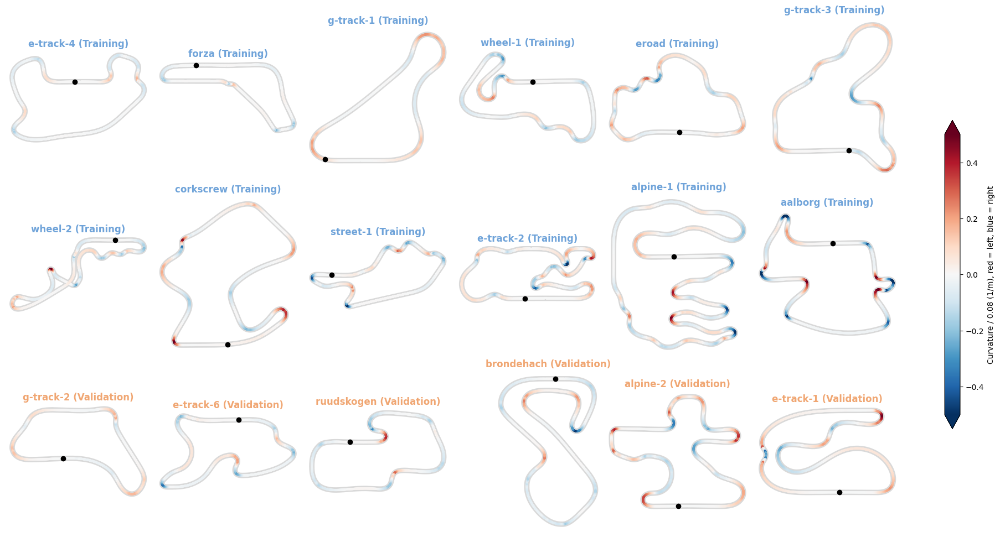
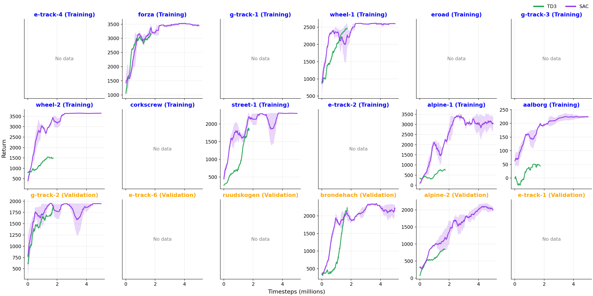
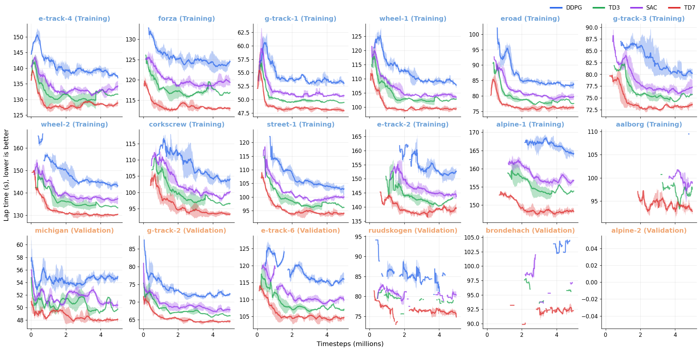
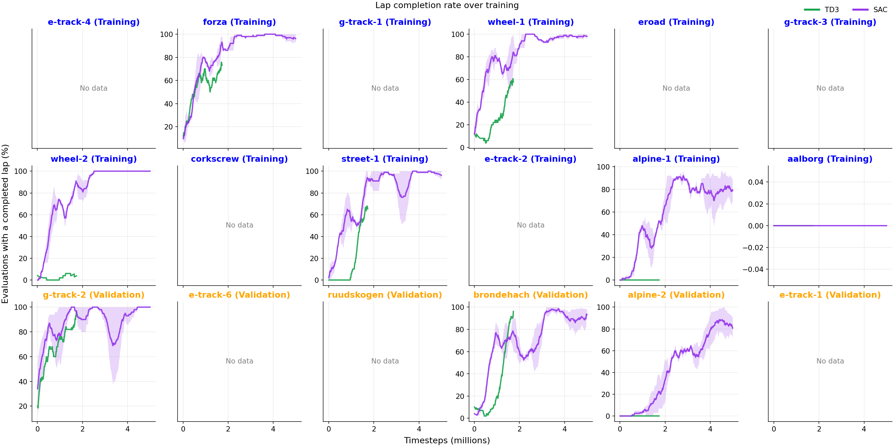
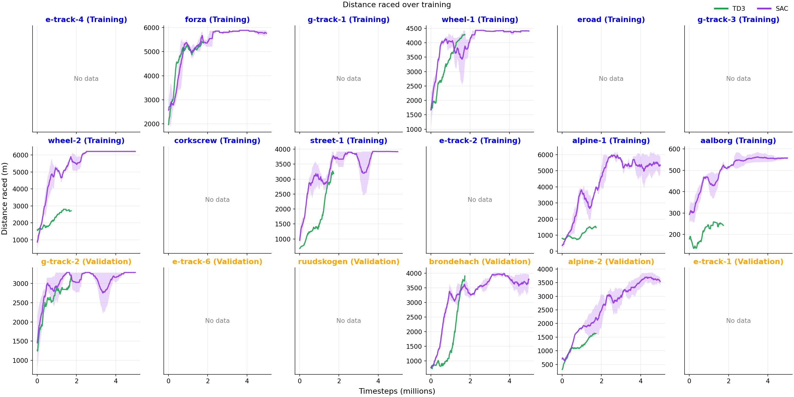

# Deep Reinforcement Learning on TORCS

Model-free off-policy deep reinforcement learning on TORCS.

<p align="center">
  
</p>

<p align="center"> <em>Gif: Trained TD3 policy racing on Alpine-1.</em> </p>

## Algorithms

* DDPG: ["Continuous control with deep reinforcement learning"](https://arxiv.org/abs/1509.02971), Lillicrap et al., 2015

* TD3: ["Addressing Function Approximation Error in Actor-Critic Methods"](https://arxiv.org/abs/1802.09477), Fujimoto et al., 2018

* SAC: ["Soft Actor-Critic: Off-Policy Maximum Entropy Deep Reinforcement Learning with a Stochastic Actor"](https://arxiv.org/abs/1801.01290), Haaranoja et al., 2018

* TD7: ["For SALE: State-Action Representation Learning for Deep Reinforcement Learning"](https://arxiv.org/abs/2306.02451), Fujimoto et al., 2023


## Usage

Before training, record the racing lines the environment needs (see [`gym_torcs/README.md`](gym_torcs/README.md#racing-lines)):

```bash
python scripts/collect_racing_lines.py --laps 10
```

### Training

```python
from gym_torcs import HistoryWrapper, TimedTrackSelectionWrapper, TorcsEnv, TrackSpec
from torcsrl import TD3

# Select training tracks
TRAIN_TRACKS = [TrackSpec(name) for name in ["alpine-1", "aalborg", "street-1", "forza", "wheel-1", "wheel-2"]]

# Select validation tracks
VAL_TRACKS = [TrackSpec(name) for name in ["g-track-2", "brondehach", "alpine-2"]]

# History observation wrapper settings
#
# NOTE: This is really important to prevent the agent from "shaky steering control"...
# Thanks to Antonin Raffin, he found that the solution to smooth the control is to constrain the change in steering angle while augmenting the input with the history of previous commands.
# Read more here:
# https://medium.com/data-science/learning-to-drive-smoothly-in-minutes-450a7cdb35f4
# https://github.com/araffin/learning-to-drive-in-5-minutes 
HISTORY_OBS, HISTORY_ACT = 3, 3

# Agent drives one track at a time and switches to the next track every 50k steps.
TRAIN_SWITCH_EVERY_STEPS = 50_000

# Share of training episodes that start somewhere on the lap instead of the grid.
# Validation always starts on the grid.
TRAIN_RANDOM_START = 0.8

train_env = TorcsEnv(port=3001, track=TRAIN_TRACKS[0], random_start=TRAIN_RANDOM_START)
train_env = HistoryWrapper(train_env, HISTORY_OBS, HISTORY_ACT)
train_env = TimedTrackSelectionWrapper(train_env, TRAIN_TRACKS, switch_every_steps=TRAIN_SWITCH_EVERY_STEPS)

val_env = TorcsEnv(port=3002, track=VAL_TRACKS[0])
val_env = HistoryWrapper(val_env, HISTORY_OBS, HISTORY_ACT)
val_env = TimedTrackSelectionWrapper(val_env, TRAIN_TRACKS + VAL_TRACKS, switch_every_steps=1)

# Horizon = 1 / (1 - gamma) = ~333.33 steps = ~6.67seconds
GAMMA = 0.997

# Number of env steps
TRAINING_STEPS = 5_000_000

agent = TD3(train_env, val_env, ac_kwargs={"h1_dim": 256, "h2_dim": 256}, gamma=GAMMA, device="cuda")
agent.train(TRAINING_STEPS)
```

## Install

Tested on Ubuntu 26.04 and Fedora Linux 44 Workstation.

### 1. TORCS 1.3.7 with the SCR server patch

1. Clone the TORCS repository:

```bash
git clone https://github.com/raphaelsenn/torcs-1.3.7
```

2. Enter the repository:

```bash
cd torcs-1.3.7
```

3. Install the required packages:

<details open>
<summary><b>Ubuntu 26.04</b></summary>

```bash
sudo apt install -y \
    libglib2.0-dev \
    libgl1-mesa-dev \
    libglu1-mesa-dev \
    freeglut3-dev \
    libplib-dev \
    libopenal-dev \
    libalut-dev \
    libxi-dev \
    libxmu-dev \
    libxrender-dev \
    libxrandr-dev \
    libpng-dev \
    libvorbis-dev \
    gcc \
    g++ \
    make \
    cmake \
    automake \
    autoconf \
    libtool \
    libxxf86vm-dev \
    xautomation
```

</details>

<details>
<summary><b>Fedora Linux 44 Workstation</b></summary>

```bash
sudo dnf install \
  glib2-devel \
  mesa-libGL-devel \
  mesa-libGLU-devel \
  freeglut-devel \
  plib-devel \
  openal-soft-devel \
  freealut-devel \
  libXi-devel \
  libXmu-devel \
  libXrender-devel \
  libXrandr-devel \
  libpng-devel \
  libvorbis-devel \
  gcc \
  gcc-c++ \
  make \
  cmake \
  automake \
  autoconf \
  libtool \
  libXxf86vm-devel \
  xautomation
```

</details>

4. Build and install TORCS:

```bash
make
sudo make install
sudo make datainstall
```

You should now be able to start TORCS with:

```bash
sudo torcs
```

### 2. `torcsrl`

1. Clone the repository:

```bash
git clone https://github.com/raphaelsenn/torcsrl
```

2. Enter the repository:

```bash
cd torcsrl
```

3. Create and activate a conda environment:

```bash
conda create -n torcsrl python=3.11 -y
conda activate torcsrl
```

4. Install the Python requirements:

```bash
pip install -r requirements.txt
```

5. Install `torcsrl` in editable mode:

```bash
pip install -e .
```

## Experiment

* DDPG, TD3, SAC and TD7 were each trained for 5M environment steps on 12 training tracks
and validated on 6 held-out tracks

* The agent drives one training track at a time and moves on to the next one every 25,000 steps

* Every 10,000 steps the policy is evaluated for one episode on each of the 18 tracks (12 training + 6 validation)

* At the beginning of training the replay buffer is filled with 25,000 transitions from the `tita` expert bot with added Gaussian noise.


| Split | Tracks |
| --- | --- |
| Training (12) | e-track-4, forza, g-track-1, wheel-1, eroad, g-track-3, wheel-2, corkscrew, street-1, e-track-2, alpine-1, aalborg |
| Validation (6) | michigan, g-track-2, e-track-6, ruudskogen, brondehach, alpine-2 |

<p align="center">
  
</p>

<p align="center"> <em>Figure 1: Training (blue) and validation (orange) tracks, colored by the curvature of the racing line.</em> </p>

### Results

<p align="center">
  
</p>

<p align="center"> <em>Figure 2: Return on training and validation tracks. </em> </p>

<p align="center">
  
</p>

<p align="center"> <em>Figure 3: Lap time per evaluation. </em> </p>

<p align="center">
  
</p>

<p align="center"> <em>Figure 4: Share of evaluations that completed a lap. </em> </p>

<p align="center">
  
</p>

<p align="center"> <em>Figure 5: Distance raced per evaluation. </em> </p>

### Hyperparameters

Shared by all algorithms:

| Setting | Value |
| --- | --- |
| Timesteps | 5,000,000 |
| Action repeat | 2 (25 Hz) |
| History (obs / actions) | 3 / 3 |
| Track switch every | 25,000 steps |
| Random start probability | 0.5 (training only) |
| Optimizer | Adam |
| Discount γ | 0.994 (horizon ≈ 167 steps ≈ 6.7 s) |
| Batch size | 256 |
| Buffer size | 5,000,000 |
| Warmup | 25,000 steps, noisy `tita` expert |
| Evaluation | every 10,000 steps, 1 episode per track |

Per algorithm:

| Algorithm | Actor LR | Critic LR | Other LR | Hidden units | Polyak τ | Policy delay | Exploration | Extra |
| --- | ---: | ---: | --- | --- | ---: | ---: | --- | --- |
| DDPG | 3e-4 | 3e-4 | – | 512, 512 | 0.005 | 2 | Gaussian, σ = 0.1 | – |
| TD3 | 3e-4 | 3e-4 | – | 512, 512 | 0.005 | 2 | Gaussian, σ = 0.1 | target noise σ = 0.2, clip 0.5 |
| SAC | 3e-4 | 3e-4 | α: 3e-4 | 256, 256 | 0.005 | – | stochastic policy | learned temperature α |
| TD7 | 3e-4 | 3e-4 | encoder: 3e-4 | 256 (z<sub>s</sub> dim 256) | – (hard update every 250 steps) | 2 | Gaussian, σ = 0.1 | LAP (α = 0.4, min priority 1), target noise σ = 0.2, clip 0.5 |

### Reproducing the Experiment

Just run: 

```bash
bash ./scripts/run.sh
```

## Citations

```bibtex
@misc{lillicrap2019continuouscontroldeepreinforcement,
      title={Continuous control with deep reinforcement learning}, 
      author={Timothy P. Lillicrap and Jonathan J. Hunt and Alexander Pritzel and Nicolas Heess and Tom Erez and Yuval Tassa and David Silver and Daan Wierstra},
      year={2019},
      eprint={1509.02971},
      archivePrefix={arXiv},
      primaryClass={cs.LG},
      url={https://arxiv.org/abs/1509.02971}, 
}

@misc{fujimoto2018addressingfunctionapproximationerror,
      title={Addressing Function Approximation Error in Actor-Critic Methods}, 
      author={Scott Fujimoto and Herke van Hoof and David Meger},
      year={2018},
      eprint={1802.09477},
      archivePrefix={arXiv},
      primaryClass={cs.AI},
      url={https://arxiv.org/abs/1802.09477}, 
}

@misc{haarnoja2018softactorcriticoffpolicymaximum,
      title={Soft Actor-Critic: Off-Policy Maximum Entropy Deep Reinforcement Learning with a Stochastic Actor}, 
      author={Tuomas Haarnoja and Aurick Zhou and Pieter Abbeel and Sergey Levine},
      year={2018},
      eprint={1801.01290},
      archivePrefix={arXiv},
      primaryClass={cs.LG},
      url={https://arxiv.org/abs/1801.01290}, 
}

@misc{fujimoto2023salestateactionrepresentationlearning,
      title={For SALE: State-Action Representation Learning for Deep Reinforcement Learning}, 
      author={Scott Fujimoto and Wei-Di Chang and Edward J. Smith and Shixiang Shane Gu and Doina Precup and David Meger},
      year={2023},
      eprint={2306.02451},
      archivePrefix={arXiv},
      primaryClass={cs.LG},
      url={https://arxiv.org/abs/2306.02451}, 
}
```
