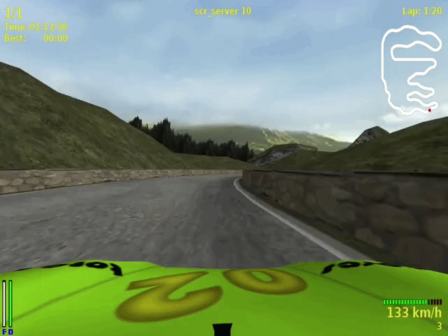
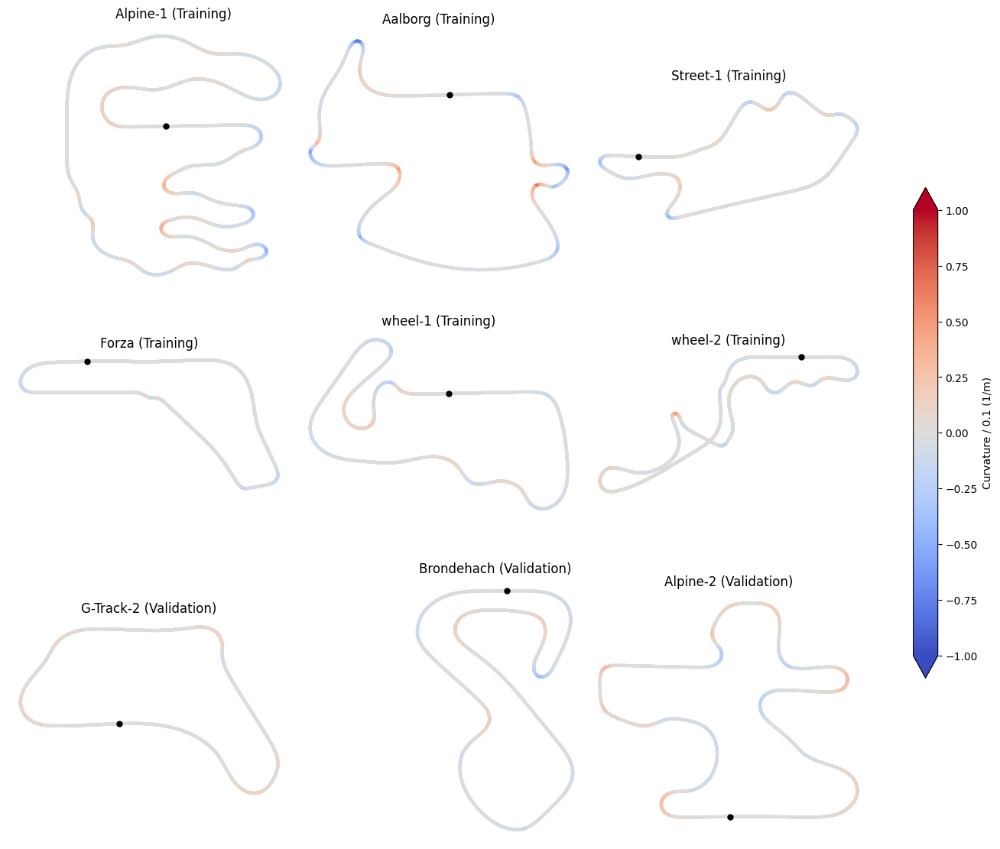

<<<<<<< HEAD
# torcsrl
=======
# Deep Reinforcement Learning on TORCS

There are several TORCS reinforcement learning projects, many of them are based on older codebases and use old versions of Keras or TensorFlow.
>>>>>>> 44af3fa (Add vison observations to gym_torcs; refactoring trocsrl/algorithms/base.py; refactoring gym_torcs)

This repo provides a modern PyTorch implementation/interface for training RL agents in TORCS. It uses a Gymnasium environment interface and provides configurable training and evaluation tracks.

<p align="center">
  
</p>

<p align="center"> <em>Gif: Trained TD3 policy racing on Alpine-1.</em> </p>

## Implemented Algoritms

* DDPG (N-Step)
* TD3 (N-Step)
* SAC (N-Step; Not evaluated yet - due to limited compute)
* TD7 (Not evaluated yet - due to limited compute )

## Environment

|                                    |                                                                                                  |
| ---------------------------------- | ------------------------------------------------------------------------------------------------ |
| Action Space                       | `Box(-1.0, 1.0, (2,), float32)`                                                                  |
| Observation Space                  | `Box(-1.0, 1.0, (45,), float32)`                                                                 |
| Observation Space (`vision=True`)  | `Dict("state": Box(-1.0, 1.0, (45,), float32), "image": Box(0, 255, (H, W, 3), uint8))`          |
| import                             | `gym.make("TorcsSCR-v0")`                                                                        |

### Action Space

The action is an `ndarray` with shape `(2,)`. Gears are shifted automatically.

| Num | Action                                              | Min  | Max |
| --- | --------------------------------------------------- | ---- | --- |
| 0   | Steering, `-1` is full right, `1` is full left      | -1.0 | 1.0 |
| 1   | Throttle, positive values accelerate, negative brake | -1.0 | 1.0 |

### Observation Space (vector)

The observation is an `ndarray` with shape `(45,)`. Every sensor is scaled to `[-1, 1]` with the constants in `gym_torcs/constants.py`,
then Gaussian noise (`observation_noise=0.025`) is added and the result is clipped to `[-1, 1]`.

| Num   | Observation                                                                        | Min  | Max | Scaled from          |
| ----- | ---------------------------------------------------------------------------------- | ---- | --- | -------------------- |
| 0-2   | Speed along the car's x, y, z axes                                                 | -1.0 | 1.0 | ±250 km/h            |
| 3-5   | Acceleration along the car's x, y, z axes                                          | -1.0 | 1.0 | ±50 m/s²             |
| 6     | Engine rpm                                                                         | -1.0 | 1.0 | 0 – 10,000 rpm       |
| 7     | Angle between the car's heading and the track axis                                 | -1.0 | 1.0 | ±π rad               |
| 8     | Lateral position on the track, `-1` is the right edge, `1` the left edge           | -1.0 | 1.0 | track width          |
| 9-27  | 19 track edge range finders at -45°, -19°, -12°, -7°, -4°, -2.5°, -1.7°, -1°, -0.5°, 0°, 0.5°, 1°, 1.7°, 2.5°, 4°, 7°, 12°, 19°, 45° | -1.0 | 1.0 | 0 – 200 m |
| 28-31 | Wheel spin velocities (front left, front right, rear left, rear right)             | -1.0 | 1.0 | 0 – 100 rad/s        |
| 32    | Lateral offset from the racing line of the `tita` robot                            | -1.0 | 1.0 | ±2 track half-widths |
| 33-44 | Racing line curvature 0, 25, 50, ..., 275 m ahead of the car                       | -1.0 | 1.0 | ±0.1 1/m             |

`HistoryWrapper(env, horizon_obs, horizon_act)` stacks the last `horizon_obs` observations and `horizon_act` actions (oldest first),
giving a `Box(-1.0, 1.0, (45 * horizon_obs + 2 * horizon_act,), float32)`, e.g. `(141,)` for `horizon_obs=3, horizon_act=3`.

### Observation Space (vision)

With `vision=True` (requires `render_mode="human"`) the observation is a `Dict`:

| Key       | Space                                    | Description                                                         |
| --------- | ---------------------------------------- | ------------------------------------------------------------------- |
| `"state"` | `Box(-1.0, 1.0, (45,), float32)`         | The vector observation above                                        |
| `"image"` | `Box(0, 255, (H, W, 3), uint8)`          | RGB image of the TORCS window, `(H, W) = image_shape`, default `(64, 64)` |

`HistoryWrapper` only supports the vector observation.

## Experiment

Note that due to my limited compute resources, I evaluated only two algorithms: DDPG and TD3. Each algorithm was trained on the six training tracks and evaluated on the three validation tracks every 10,000 timesteps. Each algorithm was trained for 5 million timesteps and evaluated across three different seeds.

#### Training and Validation Tracks

<p align="center">
  
</p>

<p align="center"> <em>Figure 1: Training and validation tracks. Alpine-1, Aalborg, Street-1, Forza, Wheel-1, and Wheel-2 are used for training, while G-Track-2, Brondehach, and Alpine-2 are used for validation.</em> </p>

<p align="center">
  
</p>

<p align="center"> <em>Figure 2: Learning curves of DDPG and TD3 on training and validation tracks. </em> </p>

#### Results

#### Hyperparameters

| Algorithm | Timesteps | Actor LR | Critic LR | N-Steps | Batch size | Buffer size | Start steps | Discount | Polyak τ | Policy delay | Exploration |
| --- | ---: | ---: | ---: | ---: | ---: | ---: | ---: | ---: | ---: | ---: | --- |
| DDPG | 5,000,000 | 3e-4 | 3e-4 | 3 | 256 | 1,000,000 | 10,000 | 0.992 | 0.005 | 2 | Gaussian, σ = 0.1 |
| TD3 | 5,000,000 | 3e-4 | 3e-4 | 3 | 256 | 1,000,000 | 10,000 | 0.992 | 0.005 | 2 | Gaussian, σ = 0.1 |


## Usage

### Racing lines

The look-ahead curvature is computed from racing lines recorded with the `tita` robot, stored in `data/<track>.csv`.
Record them for all experiment tracks (existing files are skipped unless `--overwrite` is given):

```bash
python scripts/collect_racing_lines.py --laps 10
python scripts/collect_racing_lines.py forza alpine-2 --overwrite
```

### Training

`scripts/train.py` trains on the six training tracks, switching track every 50,000 steps, and evaluates on all nine tracks every 10,000 steps.
Track lists and hyperparameters live in `scripts/configs.py`.

```bash
python scripts/train.py --algorithm td3 --seed 0 --device cuda   # ddpg, td3, sac, td7
./scripts/run.sh --device cuda                                   # the README experiment: DDPG and TD3, seeds 0-2
```

Each environment drives one SCR robot slot, so every environment needs its own port in `3001..3010`.
The validation env uses `--port + 1`; give parallel runs ports at least two apart.
Checkpoints and evaluation statistics are written to `./checkpoints`.

### Watching an agent drive

`scripts/evaluate.py` opens the TORCS window and drives a checkpoint on the training and validation tracks, printing lap times and a summary.

```bash
python scripts/evaluate.py checkpoints/nstepsac/<run>/actor-nstepsac-<step>.pt
python scripts/evaluate.py <actor.pt> --tracks brondehach alpine-2 --laps 3
python scripts/evaluate.py --expert --tracks aalborg               # the tita robot, for comparison
```

### Environment

```python
import gymnasium as gym
import gym_torcs
from gym_torcs import HistoryWrapper, TimedTrackSelectionWrapper, TrackSpec

env = gym.make("TorcsSCR-v0", port=3001, track=TrackSpec("forza", "road"))
env = HistoryWrapper(env, horizon_obs=3, horizon_act=3)
env = TimedTrackSelectionWrapper(env, [TrackSpec("forza"), TrackSpec("alpine-1")], switch_every_steps=50_000)

obs, info = env.reset(seed=0)
obs, reward, terminated, truncated, info = env.step(info["action_tita"])  # tita's action
```

### Vision

```python
env = gym.make("TorcsSCR-v0", render_mode="human", vision=True, image_shape=(64, 64))
obs, info = env.reset()
obs["state"]  # (45,) float32
obs["image"]  # (64, 64, 3) uint8 RGB
```

Frames are copied from the TORCS window through shared memory, so vision needs `render_mode="human"`,
a visible window and `xte` (package `xautomation`) to start the race.
TORCS writes about ten frames per simulated second, while the agent acts 50 times per second.
Only one vision environment can run per machine.

## Install

### Ubuntu 26.04

#### Install TORCS 1.3.7 with the SCR server patch

1. Clone the TORCS repository:

```bash
git clone https://github.com/raphaelsenn/torcs-1.3.7
```

2. Enter the repository:

```bash
cd torcs-1.3.7
```

3. Install the required packages:

```bash
sudo apt install -y \
    libglib2.0-dev \
    libgl1-mesa-dev \
    libglu1-mesa-dev \
    freeglut3-dev \
    libplib-dev \
    libopenal-dev \
    libalut-dev \
    libxi-dev \
    libxmu-dev \
    libxrender-dev \
    libxrandr-dev \
    libpng-dev \
    libvorbis-dev \
    gcc \
    g++ \
    make \
    cmake \
    automake \
    autoconf \
    libtool \
    libxxf86vm-dev \
    xautomation
```

4. Build and install TORCS:

```bash
make
sudo make install
sudo make datainstall
```

#### Install `torcsrl`

1. Clone the repository:

```bash
git clone https://github.com/raphaelsenn/torcsrl
```

2. Enter the repository:

```bash
cd torcsrl
```

3. Create and activate a conda environment:

```bash
conda create -n torcsrl python=3.11 -y
conda activate torcsrl
```

4. Install the Python requirements:

```bash
pip install -r requirements.txt
```

5. Install `torcsrl` in editable mode:

```bash
pip install -e .
```

### Fedora Linux 44 Workstation

#### Install TORCS 1.3.7 with the SCR server patch

1. Clone the TORCS repository:

```bash
git clone https://github.com/raphaelsenn/torcs-1.3.7
```

2. Enter the repository:

```bash
cd torcs-1.3.7
```

3. Install the required packages:

```bash
sudo dnf install \
  glib2-devel \
  mesa-libGL-devel \
  mesa-libGLU-devel \
  freeglut-devel \
  plib-devel \
  openal-soft-devel \
  freealut-devel \
  libXi-devel \
  libXmu-devel \
  libXrender-devel \
  libXrandr-devel \
  libpng-devel \
  libvorbis-devel \
  gcc \
  gcc-c++ \
  make \
  cmake \
  automake \
  autoconf \
  libtool \
  libXxf86vm-devel \
  xautomation
```

4. Build and install TORCS:

```bash
make
sudo make install
sudo make datainstall
```

You should now be able to start TORCS with:

```bash
sudo torcs
```

#### Install `torcsrl`

1. Clone the repository:

```bash
git clone https://github.com/raphaelsenn/torcsrl
```

2. Enter the repository:

```bash
cd torcsrl
```

3. Create and activate a conda environment:

```bash
conda create -n torcsrl python=3.11 -y
conda activate torcsrl
```

4. Install the Python requirements:

```bash
pip install -r requirements.txt
```

5. Install `torcsrl` in editable mode:

```bash
pip install -e .
```

## Citations

```bibtex
@misc{lillicrap2019continuouscontroldeepreinforcement,
      title={Continuous control with deep reinforcement learning}, 
      author={Timothy P. Lillicrap and Jonathan J. Hunt and Alexander Pritzel and Nicolas Heess and Tom Erez and Yuval Tassa and David Silver and Daan Wierstra},
      year={2019},
      eprint={1509.02971},
      archivePrefix={arXiv},
      primaryClass={cs.LG},
      url={https://arxiv.org/abs/1509.02971}, 
}

@misc{fujimoto2018addressingfunctionapproximationerror,
      title={Addressing Function Approximation Error in Actor-Critic Methods}, 
      author={Scott Fujimoto and Herke van Hoof and David Meger},
      year={2018},
      eprint={1802.09477},
      archivePrefix={arXiv},
      primaryClass={cs.AI},
      url={https://arxiv.org/abs/1802.09477}, 
}

@misc{haarnoja2018softactorcriticoffpolicymaximum,
      title={Soft Actor-Critic: Off-Policy Maximum Entropy Deep Reinforcement Learning with a Stochastic Actor}, 
      author={Tuomas Haarnoja and Aurick Zhou and Pieter Abbeel and Sergey Levine},
      year={2018},
      eprint={1801.01290},
      archivePrefix={arXiv},
      primaryClass={cs.LG},
      url={https://arxiv.org/abs/1801.01290}, 
}


@misc{fujimoto2023salestateactionrepresentationlearning,
      title={For SALE: State-Action Representation Learning for Deep Reinforcement Learning}, 
      author={Scott Fujimoto and Wei-Di Chang and Edward J. Smith and Shixiang Shane Gu and Doina Precup and David Meger},
      year={2023},
      eprint={2306.02451},
      archivePrefix={arXiv},
      primaryClass={cs.LG},
      url={https://arxiv.org/abs/2306.02451}, 
}
```
